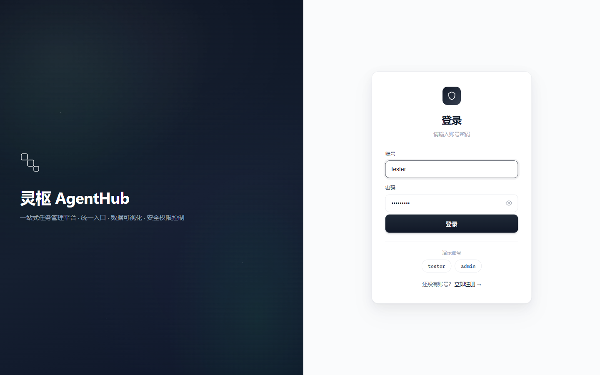
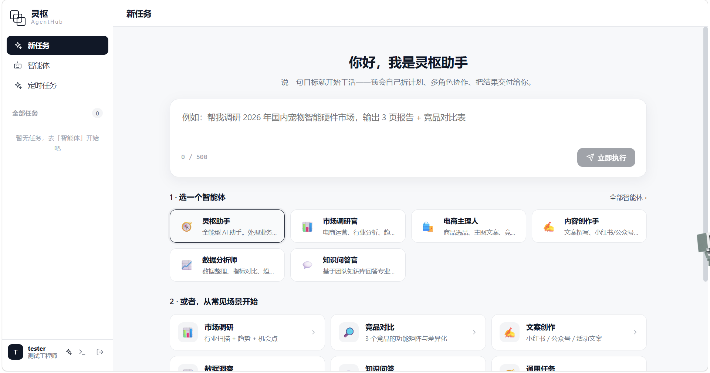
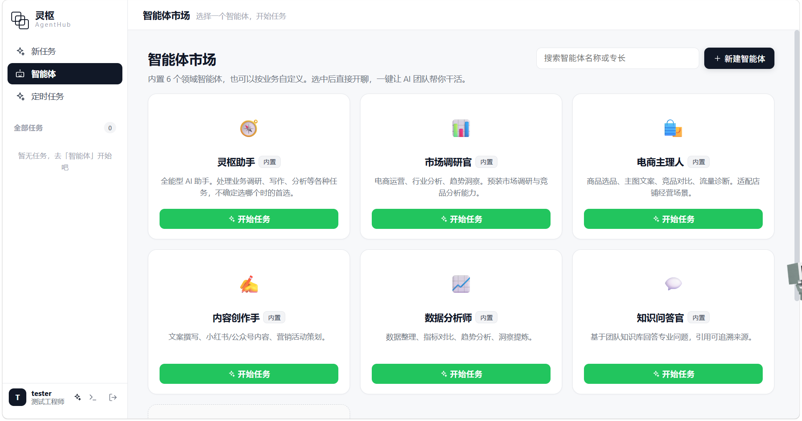
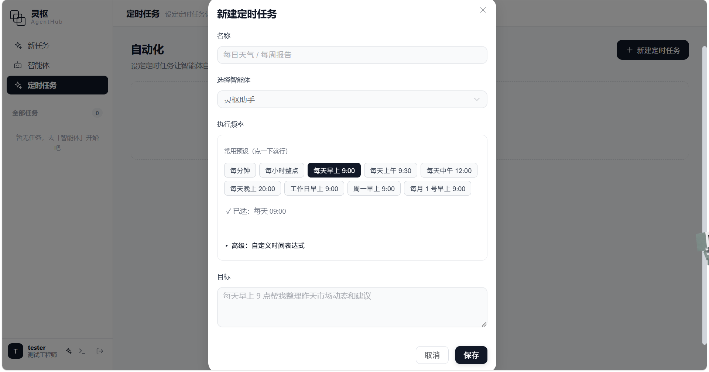
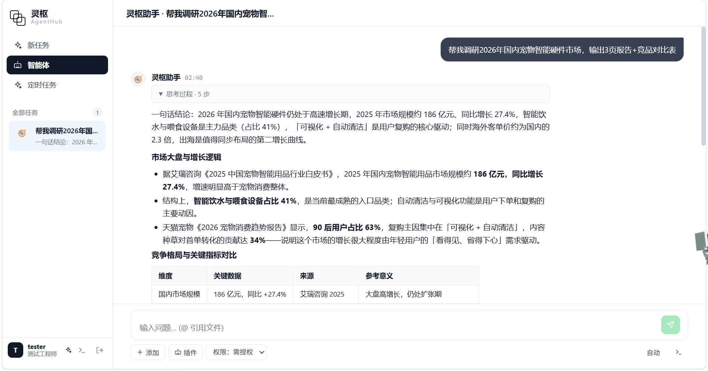
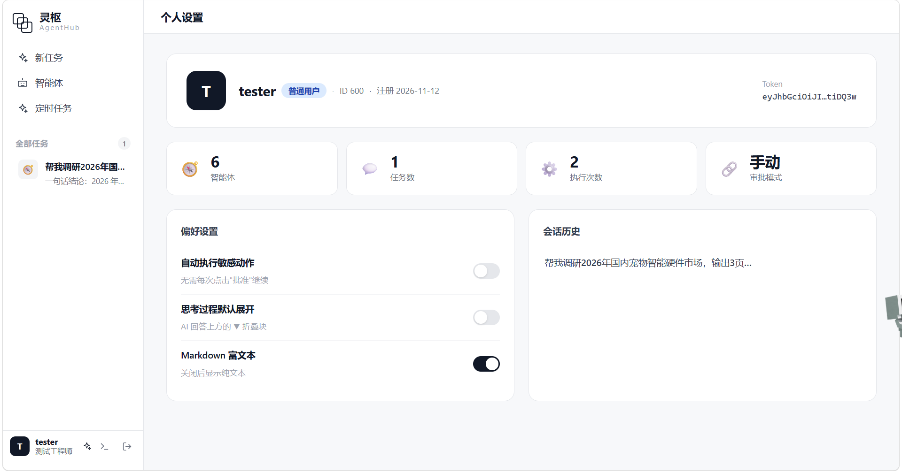
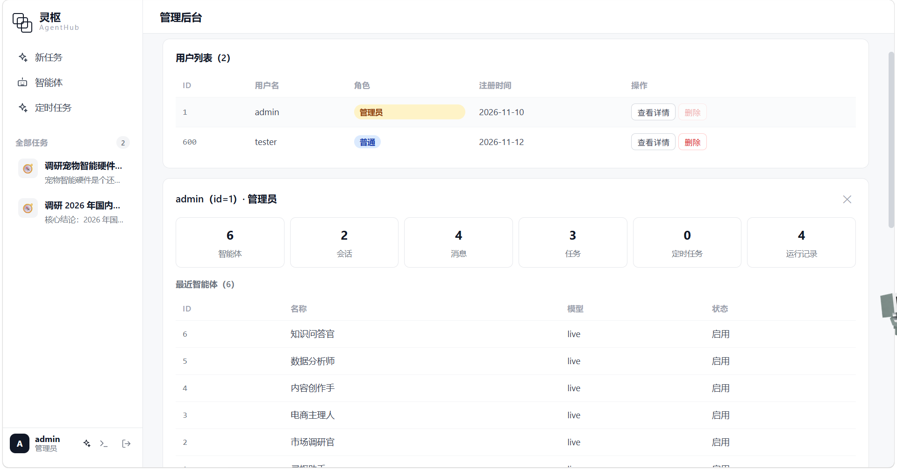

# 灵枢 AgentHub · 任务型智能体工作台

> 一句话目标 → 智能体团队自动规划 → 多角色分工执行 → 交付物（Vue 3 用户端 + FastAPI 后端 + MySQL + APScheduler 定时任务）

## 项目简介

**灵枢 AgentHub** 是面向内容创作、市场调研、数据分析等场景的任务型智能体工作台。用户输入一句目标，系统自动匹配技能模板、拆成 4-5 个可执行步骤、分派给 4 个内置角色（调研员 / 分析师 / 撰写员 / 审核员），每步调用对应的能力工具（网页检索 / 数据抓取 / 数据分析 / 知识召回 / 报告撰写），最终交付回答。

后端单服务架构（FastAPI + MySQL），前端 Vue 3 + Element Plus。内置 APScheduler 后台调度，用户可在前端一键创建定时任务（预设：每天 9 点 / 工作日 9 点 / 每月 1 号 9 点），无需接触 Cron 表达式。管理端为 ADMIN 角色专属，可查看所有用户、跨用户数据统计、数据库表状态、定时调度器运行情况，并支持级联删除。

本项目后端由 **3 个 router 文件 + main.py 1 个全局端点**（auth.py 4 / chat.py 13 / ops.py 6 / main.py /health 1）共 **24 个 REST 端点 / 7 种能力工具** 组成，覆盖：注册登录 → 智能体市场 → 会话对话 → 授权门禁 → 交付物下载 → 定时任务 → 管理后台审计的完整闭环。

## 预览
### 1. 登录：输账号密码，或直接点演示账号

打开就是这页，左边深色品牌区，右边白色表单。**tester** 和 **admin** 是两个内置演示账号，点一下自动填好。

账号：`admin` / 密码：`admin123`（管理员，能进管理后台）
账号：`tester` / 密码：`tester123`（普通用户）



### 2. 新任务：说一句话就行

登录后进来，页面上方有输入框——**你想做什么就说什么**，不用想步骤。
然后分两步：**选一个智能体**（6 个内置的，点一下就好），**或者从常见场景开始**（市场调研、竞品对比、文案创作、数据洞察、知识问答、通用任务）。

右下角那个 **立即执行** 按钮一按，灵枢就会自动拆成好几步，每一步找谁干都安排好，结果会交付给你。



### 3. 智能体市场：6 个内置的"专家"，也能自己造

点左侧 **智能体** 进去，这 6 个是系统内置的，每个有专长：

| 智能体 | 干啥的 |
|---|---|
| 灵枢助手 | 全能型，不知道选哪个时的兜底 |
| 市场调研官 | 行业分析、趋势洞察、竞品对比 |
| 电商主理人 | 选品、文案、活动策划 |
| 内容创作手 | 小红书 / 公众号 / 营销文案 |
| 数据分析师 | 整理数据、对标对比、指标洞察 |
| 知识问答官 | 引用团队知识库回答 |

每个卡片上都有 **开始任务** 按钮，点了直接开干。右上角 **+ 新建智能体** 可以按团队需求自己造一个。



### 4. 定时任务：不用写 Cron，点按钮就行

**定时任务** 页面 → **+ 新建定时任务**：

- **常用预设（点一下就行）**：每分钟、每小时整点、每天早上 9:00、每天晚上 20:00、工作日早上 9:00、周一早上 9:00、每月 1 号早上 9:00
- 选中后下面出现 ✓ **已选：每天 09:00**（纯中文描述）
- 想看/要自定义？**高级：自定义时间表达式** 才展开（附格式说明）
- 目标框填"每天早上 9 点帮我整理昨天市场动态和建议"，保存就完事

后端 APScheduler 自动注册，到点自动跑，Asia/Shanghai 时区，重启也会恢复。



### 5. 执行结果：思考过程 + 真实数据 + 引用来源

执行完成后进入这个聊天式结果页。上面有个 **思考过程 ▾** 折叠块——点开能看到每一步它是怎么想的、找谁干的。

下面是正文：**市场大盘与增长逻辑** 里有真实的数据源（艾瑞咨询 2025、天猫宠物），列了具体数字（**186 亿元**、**27.4% 增长**、饮水设备占比 **41%**、90 后用户占比 **63%**）。

再下面是 **竞争格局与关键指标对比** 表格（维度 / 关键数据 / 来源 / 参考意义），每条数据都标了来源，点进去能看原文。

> 执行到"发邮件/群通知"这种敏感操作时会自动停下来问你确认，防止 AI 乱发。
> 同一句话说两遍，出来的结果一模一样——完全可复现。



### 6. 个人设置：统计数字 + 偏好开关 + 历史会话

点左下角头像进去。左半部分：**智能体数 / 任务数 / 执行次数 / 审批模式** 4 个数字。右半部分：**偏好设置**（自动执行敏感动作要不要关、思考过程默认展不展开、Markdown 富文本开关）+ **会话历史** 列表。



### 7. 管理后台：跨用户查看 + 级联删除

只有 **admin** 登录才能进（普通用户会被 403 拦截）。

**用户管理 Tab**（你截图的这张）：
- 上面是 **用户列表**（admin + tester，每行显示 ID、角色、注册时间）
- 点 **查看详情** → 右侧弹出面板：
  - 6 个计数：智能体 / 会话 / 消息 / 任务 / **定时任务** / 运行记录
  - 下面是 **最近智能体 / 最近定时任务 / 最近任务 / 最近会话** 的小表格
- 点 **删除** 会级联删掉这个用户的所有数据（智能体、定时任务、消息、会话、任务）

另外 3 个 Tab：
- **概览**：6 张统计卡 + 数据库 + 调度器状态
- **数据库状态**：MySQL 9 张核心表，每张表显示行数 + 大小 MB
- **定时任务调度器**：APScheduler 当前注册了哪些 jobs、下次什么时候触发



后端 admin 接口真实返回（启动后 seed 数据对应的原始值）：

```
GET /api/admin/stats →
  users=2  agents=6  sessions=4  messages=18  automations=2  artifacts=1  db=mysql

GET /api/admin/users/600 →   // tester 用户详情
  agents=2  sessions=2  automations=1
  recent_agents: 灵枢助手 / 市场调研官 …
```

### 8. Swagger 在线 API 文档

后端 FastAPI 自动生成，覆盖 auth / chat / ops 三个 router（auth 4 + chat 13 + ops 6 = 23）外加 main.py 全局 `/health`，共 **24 个接口**：

```
http://127.0.0.1:8000/docs
```

## 核心功能

| # | 模块 | 说明 | 核心接口 |
|---|---|---|---|
| 1 | 登录注册 | 图形验证码 + 用户名密码注册/登录，返回 JWT token | `GET /api/captcha`、`POST /api/auth/login` |
| 2 | 智能体市场 | 列出/新建/修改智能体，每个智能体绑定可用技能范围 | `GET /api/agents`、`POST /api/agents`、`PUT /api/agents/{aid}` |
| 3 | 会话对话（核心） | 给一个目标 → 后端自动匹配技能、规划步骤、逐步执行、LLM 汇总成自然语言回答 | `POST /api/sessions/{sid}/send` |
| 4 | 授权门禁 | 目标里有"发送"、"邮件"等敏感词时自动停在门禁，用户批准后继续 | `POST /api/sessions/{sid}/approve` |
| 5 | 交付物下载 | 每次执行产出 Markdown 报告 + CSV 表格，原始文件可直接下载 | `GET /api/artifacts/{aid}/download` |
| 6 | 定时任务 | 预设按钮（隐藏 cron）+ 中文描述，APScheduler 真实调度，支持启停/删除 | `POST /api/automations` |
| 7 | 管理后台（admin） | 全量用户列表 + 级联删除、单个用户详情、数据库表状态、调度器 jobs | `GET/DELETE /api/admin/*` |

**为什么"像智能体"**：同目标永远生成同一份计划（确定性规划器），不依赖大模型也能跑全流程（默认 mock 模式）。开启 DeepSeek 时调用真实 LLM 生成更自然的报告文本。

## 技术栈

| 层 | 技术 | 说明 |
|---|---|---|
| 前端 | Vue 3 + Vite + Element Plus | 用户端 / 管理端 / 定时任务 UI |
| 后端 | FastAPI + SQLAlchemy Core + Pydantic | 单服务，所有模块同源 |
| 调度 | APScheduler BackgroundScheduler | Asia/Shanghai，misfire=60s + coalesce |
| 数据库 | MySQL 8（默认）/ SQLite（降级） | 9 张核心表，schema-mysql.sql 一键建库 |
| 向量检索 | Chroma | knowledge RAG，3 篇种子文档 / 51 chunks |
| AI | DeepSeek Chat API（可选） | 默认 mock 模式，零 API Key 可跑全流程 |
| 密码 | PBKDF2-HMAC-SHA256 | 服务端自研实现，格式 `pbkdf2_sha256$rounds$salt$digest` |
| 运行时 | Python 3.10.11 | `D:\software\Python 3.10.11`，C 盘 3.13 已删 |

## 目录结构

```
nexus-agent/
├── agent-core/
│   ├── app/
│   │   ├── main.py              # 应用装配、lifespan、scheduler.init()
│   │   ├── auth.py              # 验证码 / 注册 / 登录 / 当前用户（4 接口）
│   │   ├── chat.py              # 智能体 CRUD + 会话 + 定时任务 + 交付物（13 接口）
│   │   ├── ops.py               # 管理后台 admin/*（6 接口）
│   │   ├── scheduler.py         # APScheduler（init/add_job/remove_job/list_jobs）
│   │   ├── engine.py            # build_plan → run_step → summarize_run（核心规划执行引擎）
│   │   ├── capabilities.py      # 7 个能力工具实现
│   │   ├── skills.py            # 6 技能模板 + 4 内置角色 + 7 能力白名单（engine 引用）
│   │   ├── rag.py               # Chroma 向量检索（capabilities.knowledge 真实调用）
│   │   ├── db.py                # MySQL 访问层（query/scalar/execute）
│   │   ├── security.py          # 密码哈希 + JWT + role 校验
│   │   ├── llm.py               # 提示词注入检测 + 可选 DeepSeek
│   │   └── config.py            # 端口 / MySQL / DeepSeek / Chroma 路径
│   ├── run_server.py            # 启动入口
│   └── requirements.txt
├── frontend/
│   ├── src/
│   │   ├── App.vue                # 根组件 + 路由守卫
│   │   ├── main.js
│   │   ├── router.js              # 8 条路由
│   │   ├── views/
│   │   │   ├── Layout.vue         # 侧边栏 + 顶栏布局
│   │   │   ├── Login.vue          # 登录页（验证码 + 双演示账号）
│   │   │   ├── Register.vue       # 注册页
│   │   │   ├── NewTask.vue        # 新建任务页（工作台）
│   │   │   ├── Chat.vue           # 会话对话页（思考过程 + 结果）
│   │   │   ├── ExpertMarket.vue   # 智能体市场（6 内置 + 新建）
│   │   │   ├── Automations.vue    # 定时任务（9 预设 + 高级折叠）
│   │   │   ├── Profile.vue        # 个人设置页（统计 + 偏好 + 历史）
│   │   │   └── Admin.vue          # 管理后台（概览/用户/数据库/调度器 4 Tab）
│   │   ├── components/
│   │   │   ├── Icon.vue           # 图标
│   │   │   ├── TraceTimeline.vue  # 思考过程时间线
│   │   │   ├── StatCard.vue       # 数字统计卡
│   │   │   └── TrendChart.vue     # 趋势图
│   │   └── api/
│   │       └── index.js           # 统一 axios 出口 + auth/agents/sessions/automations/admin
│   └── package.json
├── database/
│   └── schema-mysql.sql         # 9 张完整表（users + tasks + task_steps + artifacts + knowledge_docs + agents + sessions + messages + automations）
├── docs/
│   ├── API.md                   # 24 接口契约
│   ├── 产品需求文档.md
│   ├── 测试计划.md
│   ├── 测试用例.md              # 136 条（接口 85 + 功能 51）
│   ├── 缺陷报告.md              # 7 条真实缺陷（P0×2/P1×4/P2×1）
│   ├── 缺陷清单_禅道导入.md
│   ├── 测试报告.md              # 接口 88 + UI 7 + 性能 send P95≈2.8s
│   └── screenshots/             # 14 张产品截图 + Playwright 自动截图
├── tests/
│   ├── api/                     # Pytest 接口自动化（88 条用例）
│   │   ├── conftest.py          # fixture + skip_captcha + base_url
│   │   ├── test_auth.py         # 11 条（注册/登录/验证码/密码哈希）
│   │   ├── test_agents.py       # 10 条（CRUD + 不存在 agent + 权限）
│   │   ├── test_sessions.py     # 22 条（会话创建 + send + 授权门禁 + 他人数据隔离）
│   │   ├── test_automations.py  # 9 条（定时任务 CRUD + cron 校验）
│   │   ├── test_artifacts.py    # 5 条（交付物下载 + 权限）
│   │   ├── test_admin.py        # 16 条（admin stats/users/db/scheduler/DELETE 级联）
│   │   └── test_security.py     # 15 条（Prompt Injection + JWT 格式 + 边界）
│   ├── ui/                      # Playwright UI 自动化（7 条用例）
│   │   └── test_ui_playwright.py
│   └── load/                    # JMeter 压测
├── software test/
│   ├── postman/                 # Postman 集合（25 请求 + 环境变量）
│   └──jmeter/                  # JMeter 三类场景（读5/混合1/写4），17 sampler，send P95≈2.8s
│    
├── knowledge/docs/              # RAG 种子文档（3 篇）
├── .github/workflows/
│   └── ci.yml                   # GitHub Actions：后端+前端+接口88条+UI7条+Allure合并
├── start.bat                     # Windows 一键启动
└── README.md
```

## 运行

### 一键启动（Windows）

```bat
start.bat
```

自动用 `D:\software\Python 3.10.11` 拉起后端 :8000 和前端 :5173。

### 手动启动

```powershell
# 后端
cd D:\nexus-agent\agent-core
D:\software\Python 3.10.11\python.exe -m pip install -r requirements.txt
D:\software\Python 3.10.11\python.exe run_server.py

# 前端（另开终端）
cd D:\nexus-agent\frontend
npm install
npm run dev
```

### 地址

| 服务 | 地址 |
|---|---|
| 用户端 | http://127.0.0.1:5173 |
| 后端 API | http://127.0.0.1:8000 |
| Swagger | http://127.0.0.1:8000/docs |
| 健康检查 | http://127.0.0.1:8000/health |

### 演示账号

| 账号 | 密码 | 角色 | 说明 |
|---|---|---|---|
| `admin` | `admin123` | ADMIN | 可访问管理后台 |
| `tester` | `tester123` | USER | 普通用户 |

### 依赖降级

| 依赖 | 用途 | 不可用时 |
|---|---|---|
| MySQL `127.0.0.1:3307/nexus_agent` | 主存储 | 自动降级 SQLite |
| APScheduler | 定时任务 | 定时任务功能不可用 |
| DeepSeek API Key | Live 模式 | 默认 mock，全功能离线可跑 |
| Chroma | 向量检索 | knowledge 能力返回空 |

## 架构

```
┌──────────────────────── Vue 3 + Element Plus (:5173) ────────────────────────┐
│  工作台 · 定时任务 · 管理后台 · 运行日志 · 评测                                │
└──────────────────────────────┬──────────────────────────────────────────────┘
                               │ REST / JWT
┌──────────────────────────────▼──────────────────────────────────────────────┐
│                    FastAPI 单服务 (:8000)                                    │
│                                                                              │
│  auth.py    注册/登录/JWT          chat.py        智能体/会话/定时任务/交付物    │
│  ops.py     admin 后台 6 接口       scheduler.py  APScheduler 定时调度            │
│  engine.py  build_plan 纯函数      capabilities.py 7 能力工具                     │
│  skills.py  6 技能模板 + 4 角色    rag.py        Chroma 向量检索                 │
│  main.py    lifespan/装配           security.py   密码哈希 + JWT 权限校验         │
│  llm.py     Prompt 注入检测        db.py/db.py   MySQL 访问层                    │
└──────────────────────────────┬──────────────────────────────────────────────┘
                               │ SQLAlchemy Core
                        MySQL 8 (:3307)
                        db/rag.py → Chroma 向量
```

### 定时任务执行链路

```
用户前端点预设「每天早上 9:00」 → POST /api/automations
  │ → scheduler.add_job(auto_id, "0 9 * * *") 注册到 APScheduler
  ▼
时间到！BackgroundScheduler 触发 _run_automation(auto_id)
  │
  ├─ create_session + add_message(user)
  ├─ engine.build_plan(agent, goal) → 4-5 步骤规划
  ├─ run_step 循环 → 每步调 capabilities.knowledge/web_search/...
  ├─ llm.summarize_run（mock 模式直接读模板）
  ├─ add_message(assistant)
  └─ update last_run_at / next_run_at
```

### 管理后台 admin/* 接口

| 接口 | 说明 |
|---|---|
| `GET /api/admin/stats` | 平台统计：users/agents/sessions/messages/automations/tasks/artifacts/docs |
| `GET /api/admin/users` | 用户列表，含每个用户 tasks 计数 |
| `GET /api/admin/users/{uid}` | 用户详情：5 项计数 + 最近 agents + automations + tasks + sessions |
| `DELETE /api/admin/users/{uid}` | 级联删除：automations → artifacts → task_steps → messages → tasks → sessions → agents → user（不能删自己） |
| `GET /api/admin/db/overview` | 数据库状态：库名 / 表数 / 总行数 / 大小 / 每张表行数 |
| `GET /api/admin/scheduler/status` | 调度器状态：运行中 / 已注册 jobs 列表 / 下次触发时间 |


### 接口 88 全绿 + UI 7 全绿 + Postman 25 全绿 + JMeter 三类场景（读 5 / 混合 1 / 写 4）压测：255 请求 HTTP 全 200，1 条 send 触发 3s 耗时断言


